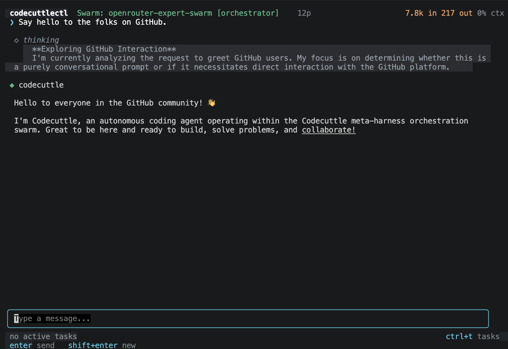

# codecuttlectl

`codecuttlectl` (`c3`) is a Go-based CLI coding agent and meta-harness. It combines foundation models with isolated tool execution, diagnostics, and optional multi-agent workflows.



## Highlights

- **Swarm Morphologies & Parallel Backlog:** Coordinate multi-agent topologies (e.g. planner, coder, reviewer) via declarative YAML definitions. Headless worker pools execute background tasks concurrently with live progress reporting in the TUI.
- **Cuttlebone Substrate (Decoupled Plugins):** Tools run as isolated gRPC subprocesses with type-safe Go struct validation, crash recovery, and runtime plugin scaffolding (`scaffold_plugin`).
- **Universal Multi-Provider Support:** First-class streaming, prompt caching, reasoning extraction, and retry resilience across **AWS Bedrock**, **OpenRouter**, **Google AI (Gemini)**, and **Ollama (local)**.
- **Inkwell Diagnostic Engine:** Real-time error classification and trace analysis. Automatically injects context-specific remediation skills when build, test, or tool errors occur.
- **Monotonic Extension Caching:** 3-tier prompt caching (tools, system prompt, conversation history) to reduce API latency and cost by up to 90%.

---

## Installation

```bash
# Clone the repository
git clone https://github.com/Modzybear/codecuttlectl.git
cd codecuttlectl

# Freshly build and atomically install codecuttlectl, plugins, and starter morphs
sudo make install
```

`make install` automatically:
1. Builds the `codecuttlectl` binary and installs it to `/usr/local/bin/codecuttlectl`.
2. Builds all Cuttlebone plugins and installs them to `/usr/local/lib/codecuttlectl/plugins/`.
3. Installs starter swarm morphologies into `/usr/local/share/codecuttlectl/morphs/`.

### Zero-Alias & Automatic Discovery

No shell wrapper or alias is required. When invoked as `codecuttlectl`, the CLI automatically discovers installed plugins and configuration across standard XDG / system locations:

- **Plugin Auto-Discovery**: Automatically searches `~/.local/share/codecuttlectl/plugins`, `~/.local/lib/codecuttlectl/plugins`, and `/usr/local/lib/codecuttlectl/plugins`.
- **Environment Variables**:
  - `CODECUTTLE_PLUGIN_DIR`: Explicit plugin directory (or `none` to disable).
  - `CODECUTTLE_MORPH`: Default morphology path or name.
  - `CODECUTTLE_CONFIG`: Path to custom configuration file.
- **User Configuration File** (`~/.config/codecuttlectl/config.yaml`):
  ```yaml
  plugin_dir: /usr/local/lib/codecuttlectl/plugins
  default_morph: openrouter-expert-swarm
  morphs_dir: ~/.config/codecuttlectl/morphs
  ```

---

## Quickstart

```bash
# Launch interactive TUI (auto-detects plugins and default morph)
codecuttlectl

# Interactive session picker (select, resume, pin, rename, or delete sessions)
codecuttlectl -s

# Resume an existing session by ID or friendly alias (auto-restores workdir and morph)
codecuttlectl -r my-feature
codecuttlectl --session ses_abc123

# List, filter, and search sessions
codecuttlectl --list-sessions
codecuttlectl --list-sessions --pinned
codecuttlectl --list-sessions --search "auth refactor" --json

# Run named morphologies from system, user (~/.config/codecuttlectl/morphs/), or project (.codecuttle/)
codecuttlectl --list-morphs
codecuttlectl --morph openrouter-expert-swarm

# Single-model runs (Bedrock default, Ollama, OpenRouter, Google Gemini)
codecuttlectl --model ollama:qwen3:32b
codecuttlectl --provider openrouter --model anthropic/claude-3.7-sonnet
codecuttlectl --provider google --model gemini-2.5-pro

# Non-interactive / scriptable execution
codecuttlectl -message "Fix compile errors in ./internal/provider"
codecuttlectl -no-tui
```

### In-Session Slash Commands

Within the interactive TUI, manage sessions and tasks with built-in slash commands:
- `/pin` — Toggle pin status on the active session (prevents pruning).
- `/alias <name>` or `/alias --clear` — Set or clear a friendly alias.
- `/title <text>` — Set a custom title for the active session.
- `/rollover` — Checkpoint and compact the session into a fresh epoch.
- `/epochs` — View all epoch summaries and ground truth for this session.
- `/plugins` — List currently loaded Cuttlebone plugins.

---

## Supported Providers

| Provider | Flag / Prefix | Example Models | Caching & Cost Tracking |
|:---|:---|:---|:---|
| **AWS Bedrock** *(default)* | `--provider bedrock` | Claude Opus 4.6, Claude Sonnet 3.7 | 3-tier checkpoint extension caching |
| **OpenRouter** | `--provider openrouter` | Claude 3.7, DeepSeek V3/R1, Qwen 2.5 | Automatic 429 retry + backoff countdown |
| **Google AI** | `--provider google` | Gemini 2.5 Pro, Gemini 2.5 Flash | Context caching with custom token threshold |
| **Ollama** | `--provider ollama` | `ollama:qwen3:32b`, `ollama:gemma4:31b` | Local inference, zero API cost |

---

## Architecture

The harness keeps model interaction, sessions, diagnostics, and plugin execution separate:

- **Engine:** serializes turns, saves sessions, tracks usage, and coordinates streaming.
- **Cuttlebone:** runs tools as isolated gRPC plugin processes with typed input schemas and restart handling.
- **Inkwell and skills:** record tool outcomes and inject relevant, versioned guidance when needed.
- **Swarm morphologies:** YAML-defined specialist nodes and permitted handoff routes. The included example uses a coordinator, implementers, and reviewers.
- **Context compaction:** limits the size of long tool results while preserving recent work.

See [`docs/architecture.md`](docs/architecture.md), [`docs/swarm-morphologies.md`](docs/swarm-morphologies.md), and [`docs/writing-plugins.md`](docs/writing-plugins.md).

---

## Tools

`codecuttlectl` includes 17 tools (12 gRPC plugins and 5 harness built-ins):

- **Filesystem & Shell:** `read_file`, `write_file`, `edit_file`, `list_directory`, `glob`, `grep`, `bash_exec`
- **Version Control & GitHub:** `git` (with destructive command safeguards), `github` (PRs, issues, comments, releases)
- **Web & Research:** `websearch` ([Exa by default, optional Parallel search](docs/web-search.md)), `webfetch` (HTML to markdown/text extraction)
- **Harness & Extensibility:** `todo_manage`, `tool_info`, `get_skill`, `go_skills`, `scaffold_plugin`, `reload_plugins`

---

## Developing Plugins

Plugins are standalone executables communicating over gRPC using the Cuttlebone protocol. To create a new plugin in Go:

```go
type SearchInput struct {
    Query string        `json:"query" jsonschema:"required" jsonschema_description:"Search query"`
    Limit types.FlexInt `json:"limit,omitempty" jsonschema_description:"Max results to return"`
}

// Scaffold instantly during any session:
// scaffold_plugin(name="cuttlebone-mytool", description="Custom tool")
```

See [`docs/writing-plugins.md`](docs/writing-plugins.md) for full plugin and skill creation guides.

---

## Development

```bash
make all      # Compile binary and all plugins
make test     # Run all package unit tests
make validate # Full test pass (unit, race detector, vet, and offline TUI tests)
```

## License

See [LICENSE](LICENSE).
